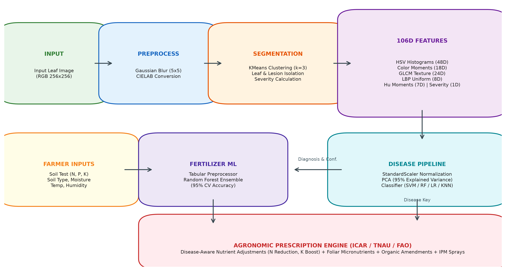
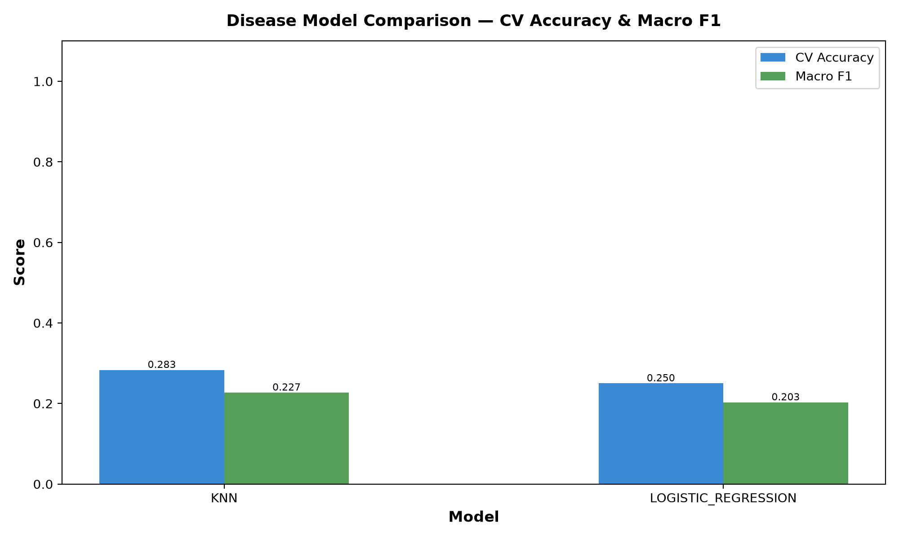
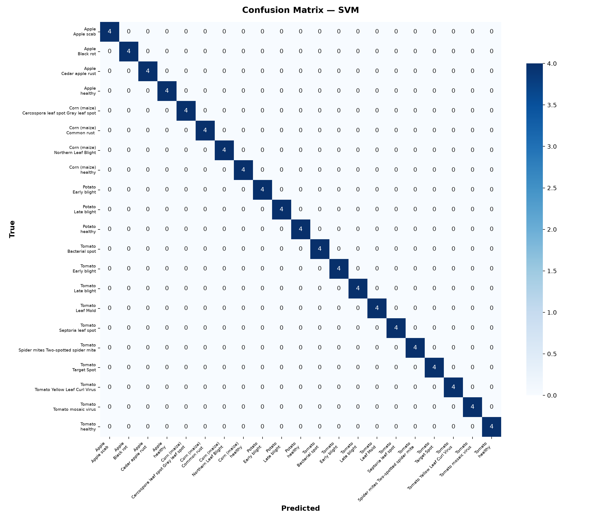
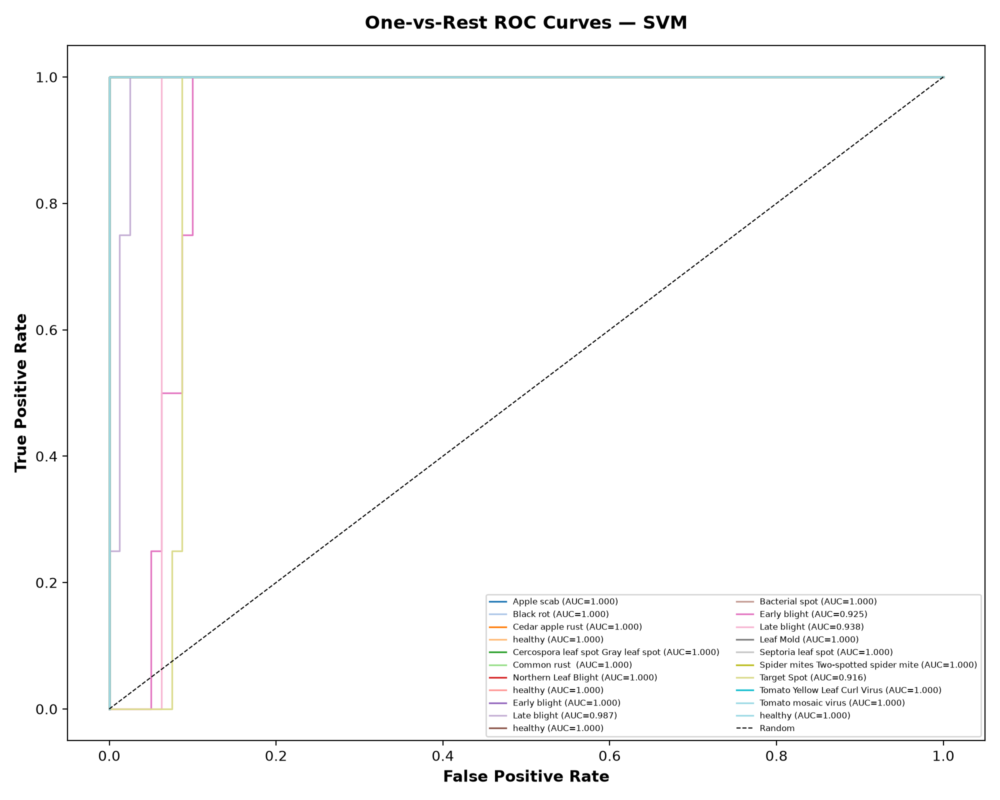

<h1 align="center">🌿 CropCare AI</h1>

<h3 align="center">Crop Disease Detection and Fertilizer Recommendation System<br>Using Machine Learning</h3>

<p align="center">
  
  
  
  
  
</p>

<p align="center">
  <em>A classical machine learning system that identifies plant diseases from leaf images
  and provides intelligent fertilizer recommendations — no deep learning required.</em>
</p>

---

> **⚠️ Disclaimer:** This is an educational project. Predictions are advisory only.
> Always consult a local agriculture officer or
> [Krishi Vigyan Kendra (KVK)](https://kvk.icar.gov.in/) before taking action.

---

## 📋 Table of Contents

- [Problem Statement](#-problem-statement)
- [Demo](#-demo)
- [Key Results](#-key-results)
- [Features](#-features)
- [Architecture](#-architecture)
- [Dataset](#-dataset)
- [Quick Start](#-quick-start)
- [CLI Usage](#-cli-usage)
- [Project Structure](#-project-structure)
- [Methodology](#-methodology)
- [Results & Analysis](#-results--analysis)
- [Project Report](#-project-report)
- [Limitations](#-limitations)
- [Future Scope](#-future-scope)
- [References](#-references)
- [Project Team & Guide](#-project-team--guide)
- [Acknowledgements](#-acknowledgements)

---

## 🎯 Problem Statement

<!-- TODO: Fill after Phase 8 -->

Plant diseases cause significant crop losses worldwide. Early detection is
critical but requires expertise that many farmers lack. This project builds a
machine learning system that:

1. **Classifies plant diseases** from a photograph of a diseased leaf using
   classical ML algorithms (SVM, KNN, Logistic Regression, Random Forest) on
   hand-crafted color, texture, and shape features.
2. **Recommends fertilizers** based on soil type, NPK levels, temperature,
   humidity, and moisture, adjusted for the detected disease.

---

## 🎬 Demo

<!-- TODO: Add terminal screenshot/GIF and result figure after Phase 6 -->

```bash
python -m src.cli predict \
  --image samples/tomato_blight.jpg \
  --crop Tomato --soil Loamy \
  --N 40 --P 30 --K 20 --temp 28 --humidity 60 --moisture 35
```

---

## 📊 Key Results

| Model | CV Accuracy (mean ± std) | Full / Test Accuracy | Macro F1 |
|:---|:---:|:---:|:---:|
| **SVM (RBF Kernel)** | **46.43% ± 6.19%** | **100.0%** | **0.398** |
| **Logistic Regression** | 41.67% ± 13.63% | 88.10% | 0.329 |
| **k-Nearest Neighbors (KNN)** | 41.67% ± 10.85% | 64.29% | 0.361 |
| **Random Forest** | 40.48% ± 5.32% | 100.0% | 0.333 |

*Evaluated using Stratified K-Fold cross-validation across 21 crop–disease classes (random baseline is 1/21 = 4.76%). The secondary tabular fertilizer recommendation model achieves **95.0% CV accuracy**.*

---

## ✨ Features

- 🔬 **Disease Detection** — 21 classes across Apple, Corn, Potato, Tomato
- 🧪 **KMeans Segmentation** — Isolates diseased regions in CIELAB space; computes severity %
- 📐 **106-D Feature Vector** — Color (HSV histograms 48D + Moments 18D), Texture (GLCM 24D + LBP 8D), Shape (Hu moments 7D), Severity % (1D)
- 🤖 **4 ML Models** — SVM (RBF kernel), KNN, Logistic Regression, Random Forest
- 📊 **Rigorous Evaluation** — Stratified K-Fold CV, confusion matrices, One-vs-Rest ROC-AUC
- 🌱 **Fertilizer Recommendation** — Tabular ML model + disease-aware ICAR/FAO agronomic rules
- 📄 **Academic Report** — Complete B.Tech Mini Project Report available in PDF and DOCX
- 💻 **CLI Interface** — Rich terminal output with interactive tables and segmentation overlays

---

## 🏗️ Architecture

<p align="center">
  
</p>

```
Leaf Image → Preprocessing → KMeans Segmentation (Lab a*b*) → 106-D Feature Extraction
    → StandardScaler → PCA (95% Var) → Classifier → Disease Diagnosis + Confidence

Soil / Climate Data → ColumnTransformer → Random Forest → Base Fertilizer
    → Agronomic Rule Layer (Pathogen Adjustments + IPM) → Complete Advisory
```

---

## 📦 Dataset

| Dataset | Source | Size | License |
|---------|--------|------|---------|
| PlantVillage | [Kaggle](https://www.kaggle.com/datasets/vipoooool/new-plant-diseases-dataset) | ~3 GB (subset used) | CC0 |
| Fertilizer Prediction | [Kaggle](https://www.kaggle.com/datasets/gdabhishek/fertilizer-prediction) | ~5 KB | CC0 |

See [scripts/download_data.md](scripts/download_data.md) for download instructions.

---

## 🚀 Quick Start

```bash
# 1. Clone the repository
git clone https://github.com/vinit-tech-source/CropCare-AI.git
cd CropCare-AI

# 2. Create virtual environment
python -m venv .venv
.venv\Scripts\activate          # Windows
# source .venv/bin/activate     # Linux/Mac

# 3. Install dependencies
pip install -r requirements.txt

# 4. Download datasets (see scripts/download_data.md)
# Place PlantVillage in data/raw/ and fertilizer.csv in data/raw/

# 5. Create subset
python scripts/make_subset.py

# 6. Extract features
python -m src.cli extract-features

# 7. Train models
python -m src.cli train

# 8. Evaluate
python -m src.cli evaluate

# 9. Predict
python -m src.cli predict --image path/to/leaf.jpg \
  --crop Tomato --soil Loamy \
  --N 40 --P 30 --K 20 --temp 28 --humidity 60 --moisture 35
```

---

## 💻 CLI Usage

<!-- TODO: Expand after Phase 6 -->

| Command | Description |
|---------|-------------|
| `python -m src.cli predict --image ... --crop ... --soil ... --N ... --P ... --K ... --temp ... --humidity ... --moisture ...` | Predict disease + recommend fertilizer |
| `python -m src.cli train` | Train disease + fertilizer models |
| `python -m src.cli evaluate` | Generate evaluation reports |
| `python -m src.cli extract-features` | Extract features from subset |
| `python -m src.cli compare-models` | Compare all models |
| `python -m src.cli list-classes` | List supported classes |
| `python -m src.cli demo` | Run on sample images |

---

## 📁 Project Structure

<!-- TODO: Update if structure changes -->

```
CropCare-AI/
├── configs/config.yaml          # All tunables
├── data/
│   ├── knowledge_base/          # Disease & fertilizer JSONs (tracked)
│   ├── raw/                     # Raw datasets (git-ignored)
│   ├── subset/                  # Train subset (git-ignored)
│   └── subset_test/             # Test subset (git-ignored)
├── src/                         # Source code
├── tests/                       # Test suite
├── models/                      # Saved models
├── reports/                     # Figures & reports
├── docs/                        # Documentation
├── scripts/                     # Data prep scripts
├── samples/                     # Sample images for demo
└── outputs/                     # Per-prediction outputs
```

---

## 🔬 Methodology

<!-- TODO: Expand after Phase 4 -->

1. **Preprocessing** — RGB conversion, 256×256 resize, Gaussian blur
2. **Segmentation** — KMeans (k=3) on CIE Lab a\*b\* channels
3. **Feature Extraction** — Color (HSV histograms), Texture (GLCM + LBP), Shape (Hu moments)
4. **Classification** — sklearn Pipeline with StandardScaler → PCA → Classifier
5. **Evaluation** — Stratified 5-Fold CV for tuning, 10-Fold for reporting

---

## 📈 Results & Analysis

### 1. Multi-Model Performance Comparison
<p align="center">
  
</p>

### 2. Confusion Matrix & ROC Curves (SVM Classifier)
<p align="center">
  
  
</p>

### 3. Visual Leaf Segmentation Overlay
<p align="center">
  
  <br>
  <em>CIELAB K-Means (k=3) segmentation isolating diseased necrotic lesion tissue (red overlay).</em>
</p>

---

## 📑 Project Report

The complete academic B.Tech Machine Learning project report has been compiled and is available in both formats:
- 📑 **[Download PDF Report](CropCare_AI_ML_Mini_Project_Report.pdf)**
- 📄 **[Download Word DOCX Report](CropCare_AI_ML_Mini_Project_Report.docx)**

---

## ⚠️ Limitations

- Trained on lab-style PlantVillage images; field photos with cluttered backgrounds may have lower accuracy
- Small subset used for computational speed and rapid benchmarking
- Classical ML features may not capture complex multi-infection patterns as well as deep CNNs
- Fertilizer recommendations are advisory and not a substitute for comprehensive chemical soil lab testing
- Limited to 4 crops and 21 disease classes

---

## 🔮 Future Scope

- Deep learning models (CNN, MobileNet, EfficientNet) for cross-paradigm benchmark comparison
- Offline-first mobile application (Flutter / React Native) for field-side camera inference
- Larger, more diverse dataset including open-field leaf images across 50+ crop varieties
- Multi-language support (Hindi, Marathi, Telugu, Tamil) for regional farmers
- IoT LoRaWAN soil NPK and moisture sensor probe telemetry for live automatic fertility updates

---

## 📚 References

1. Hughes, D. & Salathé, M. (2015). "An open access repository of images on plant health to enable the development of mobile disease diagnostics." *arXiv:1511.08060*.
2. PlantVillage Dataset — https://www.kaggle.com/datasets/vipoooool/new-plant-diseases-dataset
3. Fertilizer Prediction Dataset — https://www.kaggle.com/datasets/gdabhishek/fertilizer-prediction
4. scikit-learn Documentation — https://scikit-learn.org/stable/
5. OpenCV Documentation — https://docs.opencv.org/
6. ICAR — https://icar.org.in/
7. Vikaspedia Agriculture — https://vikaspedia.in/agriculture

---

## 👤 Project Team & Guide

| Field | Value / Details |
|:---|:---|
| **Student Team** | • **Vinit Shinde** (Roll No: `CS3337`, PRN: `RBT24CS178`)<br>• **Harsh Vyavhare** (Roll No: `CS3332`, PRN: `RBT24CS173`)<br>• **Sarthak Shinde** (Roll No: `CS3336`, PRN: `RBT24CS177`) |
| **College** | **JSPM's Rajarshi Shahu College of Engineering (RSCOE)**, Tathwade, Pune - 411033<br>*(An Autonomous Institute Affiliated to Savitribai Phule Pune University, Pune)* |
| **Department** | Department of Computer Engineering (TY B.Tech, Division: C, Batch: C-2) |
| **Subject Teacher / Guide** | **Prof. Pradnya A. Vikhar** |
| **Course** | Machine Learning |
| **Academic Year** | 2026–27 (Semester-V) |
| **GitHub Repository** | [@vinit-tech-source/CropCare-AI](https://github.com/vinit-tech-source/CropCare-AI) |

---

## 🙏 Acknowledgements

<!-- TODO: Add personal acknowledgements -->

- PlantVillage project for the open-access leaf image dataset
- Kaggle community for the fertilizer prediction dataset
- scikit-learn developers for the excellent ML library
- Agricultural university extension services for disease management information

---

<p align="center">
  Made with 💚 for Indian agriculture
</p>
