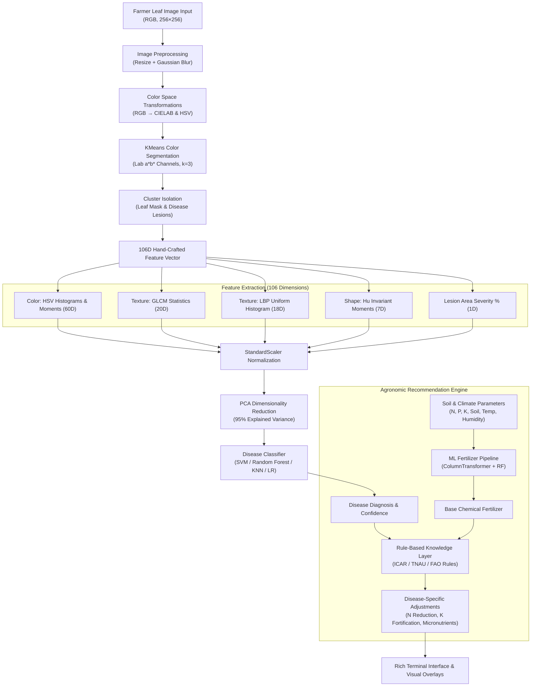
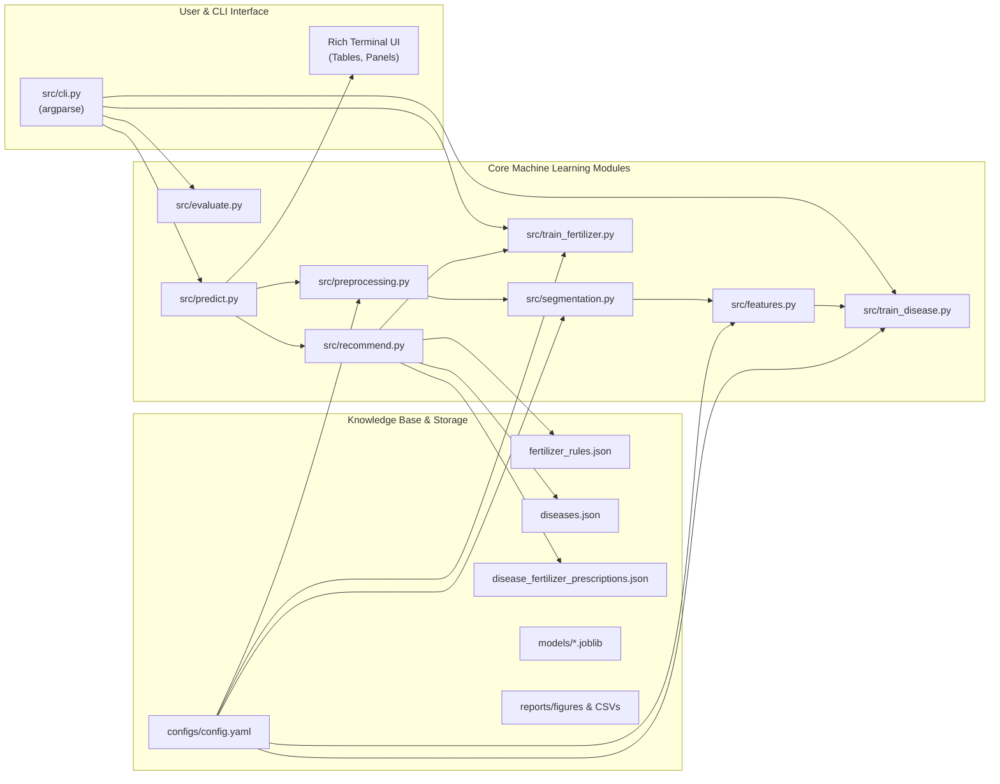

# System Architecture — CropCare AI

## 1. Executive Summary

**CropCare AI** is an explainable, classical machine learning system for crop disease detection and agronomic advisory. The system combines computer vision feature extraction on leaf imagery with multi-class tabular classifiers and an agricultural extension knowledge base to produce disease-aware fertilizer recommendations.

Unlike deep learning black-box models, CropCare AI relies exclusively on interpretable mathematical features (color distributions, texture co-occurrence matrices, invariant moments, and lesion severity ratios) coupled with scikit-learn statistical pipelines.

---

## 2. End-to-End Pipeline Overview

---

## 3. High-Level Component Architecture

---

## 4. Key Architectural Decisions

### 4.1 Strict Classical Machine Learning (No Neural Networks)
- **Rationale**: Real-world agricultural deployment in rural edge settings requires ultra-low compute overhead, rapid inference (<0.5 seconds on a single CPU core), and complete transparency for agricultural extension officers.
- **Explainability**: Every feature in the 106-dimensional vector corresponds to a physical botanical characteristic (e.g., chlorosis indicated by yellow/brown HSV bins, tissue necrosis captured by GLCM dissimilarity, and systemic spread captured by lesion severity ratio).

### 4.2 CIELAB Color Space for KMeans Segmentation
- **Decoupling Luminance from Chromance**: The $L^*$ channel represents perceptual lightness, while $a^*$ (green–red) and $b^*$ (blue–yellow) capture chromaticity. By clustering strictly in the $a^*b^*$ subspace, the segmentation algorithm remains robust against uneven sunlight, shadows, and camera exposure variances.

### 4.3 Leakage-Proof Scikit-Learn Pipeline
- To avoid data leakage, preprocessing (`StandardScaler`), dimensionality reduction (`PCA(n_components=0.95)`), and classifiers (`SVC`, `RandomForestClassifier`, `LogisticRegression`, `KNeighborsClassifier`) are encapsulated inside a single `sklearn.pipeline.Pipeline`.
- Normalization statistics and PCA projection matrices are fitted strictly on the training folds during cross-validation.

### 4.4 Two-Tier Fertilizer Advisory System
1. **Tier 1 (ML Classification)**: A Random Forest classifier with `ColumnTransformer` (StandardScaler for continuous soil parameters + OneHotEncoder for soil and crop types) predicts the baseline synthetic or complex fertilizer (e.g., Urea, DAP, 10-26-26, 20-20).
2. **Tier 2 (Agronomic Rule Engine)**: The baseline recommendation is dynamically adjusted using rule tables curated from ICAR (Indian Council of Agricultural Research) and agricultural universities. For example:
   - Fungal blights require a 25–30% reduction in nitrogen to halt succulent tissue proliferation, accompanied by a 20% increase in potassium to strengthen epidermal cell walls.
   - Calcium chloride and zinc sulphate foliar sprays are added based on the specific pathogen pathology.

---

## 5. Storage and Serialization

| Artifact Type | Path | Purpose | Format |
|---|---|---|---|
| **Disease Model** | `models/random_forest_model.joblib` | Serialized PCA + Classifier + Encoder | Joblib binary |
| **Fertilizer Model** | `models/fertilizer_model.joblib` | Serialized ColumnTransformer + Pipeline | Joblib binary |
| **Knowledge Base** | `data/knowledge_base/*.json` | Disease prescriptions, symptoms, dosages | UTF-8 JSON |
| **Configuration** | `configs/config.yaml` | Hyperparameters, paths, random seed (42) | YAML |
| **Evaluation Metrics**| `reports/model_comparison.csv` | Cross-validation scores, accuracy, F1 | CSV |
| **Visualizations** | `reports/figures/*.png` | Confusion matrices, ROC curves, elbow plot | PNG |
| **Overlay Output** | `outputs/overlays/*_segmented.png` | Segmented disease lesion mask overlays | PNG |
